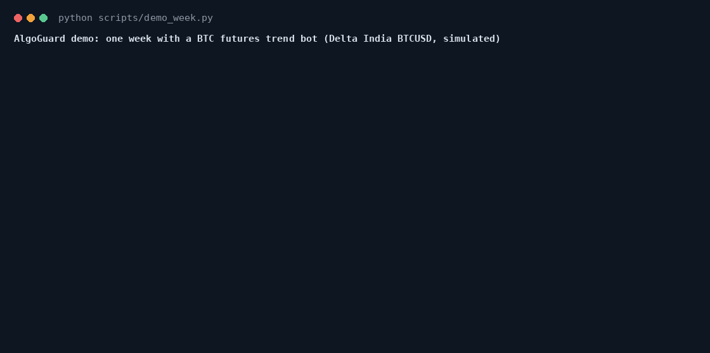

# AlgoGuard

**An AI safety layer between a trading signal and the order**, for Delta Exchange's AlgoHub Trading Bot
(TradingView webhooks) and APIs. Built for the Techfest IIT Bombay × Delta Exchange Algo Trading Innovation
Challenge.

AI models check every order and keep watching a bot after it goes live; the trader's own hard limits always
have the final say.



*The week from our Round 1 deck, run through the real code (`python scripts/demo_week.py`; simulated prices and
P&L). A duplicate alert is blocked, a 10x size slip is held and rejected, a regime shift halves the bot's size,
and the daily loss limit stops new entries even though the AI saw nothing unusual.*

**Why this matters on Delta:** the BTC perpetual on Delta Exchange India defaults to **200x leverage** with a
**0.25% maintenance margin** (Delta's public product API, Nov 2026), and Delta's own
[TradingView webhook guide](https://www.delta.exchange/support/solutions/articles/80001141030-tutorial-trading-view-automation-on-delta-exchange)
warns that when TradingView and Delta are out of sync, *"the first alert can open a larger or opposite position
than you expect"*, and that *"TradingView signals may be delayed or missed."* AlgoGuard checks for exactly these
before the order is sent. At this leverage a wrong order meets market risk at once: on 10-11 October 2025, CoinGlass
counted [$19.1B of leveraged crypto positions liquidated in one day](https://www.coingecko.com/learn/october-10-crypto-crash-explained),
about 1.6 million traders.

```
TradingView alert / API order
        │
        ▼
 Alert anomaly checker ──► Drift state ──► Hard-rule veto ──► Delta order API
 (exact + learned)         (live vs        (trader's limits,     (only on PASS)
                            backtest)       plain code)
        │                                        │
        └──────────── Explainer ◄────────────────┘   PASS · HOLD (one-tap confirm) · BLOCK
```

## What it does

| Part | File | How |
|---|---|---|
| Hard-rule veto | `algoguard/rules.py` | Daily loss, leverage, distance to liquidation, position cap, price and order-value typo guards, kill switch. Plain code; no model output feeds it. Names the limit that binds. |
| Alert anomaly checker | `algoguard/anomaly.py` | Exact checks (duplicate, stale alert, price far from mark, bursts), context checks against the real position (unexpected short or flip), and a per-bot Isolation Forest trained on the bot's own orders. Each bot's threshold learns from the trader's answers to HOLDs: a confirmed false alarm makes it a little less jumpy, a rejected order makes it stricter, within fixed bounds. Can only HOLD (duplicates BLOCK). |
| Drift detector | `algoguard/drift.py` | One-sided CUSUM tests on trade return, win rate and slippage against the trader's backtest, plus a block bootstrap of the backtest trades. Says whether the market changed, fills got worse or the edge faded, and applies the action the trader chose (alert, halve size, pause). |
| Explainer | `algoguard/explain.py` | A template reason for every decision; optionally an LLM rewrite that is discarded unless every number in it appears in the facts. |
| Guard pipeline | `algoguard/pipeline.py` | Runs the above in order of authority. If a model fails, decides on the rules alone. A confirmed HOLD is re-checked against the rules before it is sent. |
| API | `algoguard/api.py` | Webhook, API orders, holds, bots, backtest upload (including TradingView's "List of trades" CSV), live trades, drift, kill switch. |

The design rule: **the AI can make things stricter, never looser.** It can hold an order the rules allow; it
can never send an order the rules block.

**Why these models, not a large neural net or an LLM in the decision path:** every check sits on the live order
path, so it must decide in milliseconds; each finding must come with a reason a trader can read and an auditor can
re-run; and one bot has only tens to hundreds of orders to learn from. CUSUM, a block bootstrap and a per-bot
Isolation Forest fit those limits. The LLM only rewrites the explanation, and is discarded if it invents a number.

## Run it

```bash
python -m venv .venv && . .venv/bin/activate
pip install -r requirements.txt
python -m pytest -q
PYTHONPATH=. python scripts/replay_demo.py      # simulated bot with injected faults
cp .env.example .env                            # then fill it in
uvicorn algoguard.api:app --reload
```

`ALGOGUARD_DRY_RUN=true` (the default) decides and logs but never sends an order.

### Register a bot and point your Delta Trading Bot alert at it

```bash
curl -X POST localhost:8000/bots -H "Authorization: Bearer $ALGOGUARD_ADMIN_TOKEN" \
  -H "Content-Type: application/json" \
  -d '{"bot_id": "btc-trend", "limits": {"max_daily_loss": 100, "max_leverage": 5, "min_liq_distance_pct": 15}}'
```

The answer includes the bot's `secret`. **Drop-in with Delta's Trading Bot:** keep the alert *Message* JSON that
Delta's Trading Bot generated for you, unchanged (`{"symbol": "{{ticker}}", "side": "{{strategy.order.action}}",
"qty": "{{strategy.order.contracts}}", "strategy_id": ...}`), and only replace the *Notifications → Webhook URL*
with `https://<your-server>/webhook/btc-trend?key=<secret>`. AlgoGuard maps `BTCUSD.P` to Delta's `BTCUSD`,
rejects decimal lot sizes the way Delta does, and forwards orders that pass.

Optionally add `"price": {{close}}, "time": "{{timenow}}"` to the message so AlgoGuard can also catch stale alerts
and prices that moved.

Upload the backtest so drift has a baseline (`returns` as a list of % per trade, or `csv` with the
Strategy Tester export):

```bash
curl -X POST localhost:8000/bots/btc-trend/backtest -H "Authorization: Bearer $ALGOGUARD_ADMIN_TOKEN" \
  -H "Content-Type: application/json" -d '{"returns": [0.8, -0.4, 1.2, ...], "market_vol": 2.1}'
```

## Measured on real data

Details and caveats: [`docs/real_data_study.md`](docs/real_data_study.md).

- **Delta's own forum:** 15 of 49 user questions in the *APIs & Algo Trading* category (about 1 in 3) are about an
  order that did not go through as intended or a bot that could not read its own orders or positions
  ([classified list](docs/evidence/delta_forum_audit.csv)).
- **Drift on real Delta prices** (`python scripts/real_data_study.py`, BTC, ETH and SOL hourly candles, walk-forward,
  settings tuned before July 2025 and tested after): with `DriftConfig.delta_calibrated()`, drift acted in 5
  held-out bot-quarters, **all 5 of them losing quarters**, catching 5 of 12 losing quarters after a median of 22
  trades. Cutting size after the alarm saved little money in this test; the value is the early, reliable warning.

## Measured on simulated data

`scripts/replay_demo.py` replays a simulated long-only BTC bot (80 alerts to learn, then 96 normal alerts with
96 injected faults: duplicates, 10x size, stale alerts, prices far from mark, shorts the bot never takes, 25x
leverage, limit-price typos, bursts). On seeds 7-9: **100% of faults held or blocked, 0-2.1% of normal alerts
held, 99th-percentile added latency under 6 ms**.

`scripts/tune_drift.py`: with 30 live trades drawn from the backtest itself, 8.5% of runs reach "warn" and 3%
reach "act"; a shift to a losing regime reaches "act" after a median of 8 trades (90th percentile 14).

These show the prototype works as designed on faults we chose. They are not results on real bots or real money.

## Not verified yet

- **Delta API, logged-in endpoints.** The public endpoints (product, ticker) are verified against Delta
  Exchange India's live API and testnet (`tests/test_delta_live_shape.py`, with a recorded response; run
  `ALGOGUARD_LIVE=1 pytest tests/test_delta_live_shape.py` to hit the live API). Positions, wallet and order
  placement need API keys and are still tested only against mocks: run `scripts/check_delta.py` on the testnet.
- **Liquidation estimate.** `algoguard/liquidation.py` uses the standard isolated-margin formula for a new
  position, with the maintenance margin read from Delta's product data (0.25% for BTCUSD in Nov 2026). Delta's
  own reported liquidation price should be used for open positions.
- **Overlap with Delta.** Delta already rejects limit prices outside its price band (5% for BTCUSD), so
  AlgoGuard's price-gap check is a second line; its value is in size, position, leverage and drift checks.
- **TradingView CSV headers** change over time; check `parse_tradingview_csv` against a real export.
- **Telegram** sending is ported from IntelliStock, which tested it only against a mock.
- State is in memory: restarting the server forgets bots, history and holds. A database comes next.

## Licence

MIT. Parts are ported from IntelliStock and, through it, day-trader-skill; see `THIRD_PARTY_NOTICES.md`.
